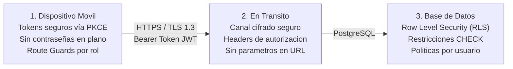

# Barro Vivo - Sistema de Gestion Artesanal

Aplicacion movil en Flutter para la gestion operativa, productiva y financiera de talleres artesanales de ceramica y talavera tradicional en Dolores Hidalgo, Guanajuato, Mexico.

Implementada bajo arquitectura **MVVM (Model-View-ViewModel)** estricta, gestion reactiva con `Provider`, enrutamiento protegido mediante `GoRouter` (Navigator 2.0) y servicios backend en la nube con **Supabase** (PostgreSQL y GoTrue Auth).

---

## 1. Acceso y Ubicacion del Proyecto (Criterio 1)

* **Repositorio Oficial en GitHub:** `https://github.com/cesargaray-dev/Barro_Vivo.git`
* **Rama Principal de Produccion:** `main`
* **Rama de Integracion Activa:** `develop`
* **Ramas de Funcionalidad:** `feature/HU-01` a `feature/HU-07`
* **Version Actual del PMV:** `1.0.0+1` (Sprint 4 en curso: HU-06 en revision)
* **Tablero de gestion (Trello):** `https://trello.com/b/iggmb32z/barrovivo` (backlog, sprint actual, en curso, en revision y hecho)
* **Integrantes del Equipo:**
  * Cesar E. Garay Garcia (Desarrollador / Responsable HU-01, HU-03, HU-05, HU-07)
  * Zahir A. Rodriguez Mora (Desarrollador / Revisor de Codigo HU-02, HU-04, HU-06)

---

## 2. Descripcion y Alcance de la Aplicacion (Criterio 2)

Barro Vivo digitaliza el ciclo completo del taller artesanal:
1. **Autenticacion con Roles (HU-02):** Acceso diferenciado para el Maestro Artesano/Dueno (`taller`) y Compradores (`cliente`).
2. **Inventario de Materias Primas (HU-03 / HU-04):** Control de stock de arcillas, fritas, esmaltes y pigmentos con alertas reactivas de stock minimo.
3. **Control de Produccion y Horno (HU-05):** Registro de lotes y avance secuencial estricto por las 5 etapas del oficio tradicional:
   `Barro Crudo -> Jahuete (1ra Quema) -> Esmaltado -> Decorado a Mano -> Terminado (2da Quema)`.
4. **Panel Financiero y Costos Reales (HU-07):** Calculo del costo unitario real sumando la materia prima consumida mas la merma prorrateada absorbida por las piezas utiles, desglose de costos por categoria y simulador de utilidad y margen de ganancia frente al precio de venta.

---

## 3. Requisitos del Sistema y Entorno de Ejecucion (Criterio 2)

Para compilar y ejecutar el proyecto se requiere:
* **Flutter SDK:** Version `>= 3.13.0 < 4.0.0` (Probado en Flutter 3.24.x o superior).
* **Dart SDK:** Version `>= 3.5.0 < 4.0.0`.
* **Entorno de Desarrollo:** Visual Studio Code o Android Studio con extensiones oficiales de Flutter y Dart.
* **Dispositivo de Pruebas:**
  * Dispositivo fisico Android con depuracion USB o inalambrica (ADB Wireless).
  * Emulador Android (API 30 o superior con Google APIs).
  * Navegador Google Chrome para ejecucion web (`flutter run -d chrome`).
  * Windows Desktop para ejecucion nativa (`flutter run -d windows`).

---

## 4. Guia Paso a Paso para la Instalacion y Ejecucion (Criterio 2)

### Paso 1: Clonar el repositorio
```bash
git clone https://github.com/cesargaray-dev/Barro_Vivo.git
cd Barro_Vivo
git checkout develop
```

### Paso 2: Instalar las dependencias de Flutter
```bash
flutter pub get
```

### Paso 3: Configurar variables de entorno de la nube
Copia el archivo de plantilla seguro `.env.example` para crear tu `.env` local:

* En Windows (PowerShell):
  ```powershell
  Copy-Item .env.example .env
  ```
* En Linux / macOS:
  ```bash
  cp .env.example .env
  ```

Edita `.env` con las credenciales anonimas de tu instancia de Supabase:
```env
SUPABASE_URL=https://tu-proyecto.supabase.co
SUPABASE_ANON_KEY=tu-anon-key-aqui
```

### Paso 4: Ejecutar la aplicacion
Inyecta las variables de entorno de forma segura durante la ejecucion:

* **En Android (dispositivo conectado o emulador):**
  ```bash
  flutter run --dart-define-from-file=.env
  ```
* **En Google Chrome (Web):**
  ```bash
  flutter run -d chrome --dart-define-from-file=.env
  ```
* **En Windows (Desktop):**
  ```bash
  flutter run -d windows --dart-define-from-file=.env
  ```

### Paso 5: Conexion inalambrica para celular Android (Opcional - ADB Wireless)
Tu herramienta `adb` se ubica por defecto en:
```powershell
$env:LOCALAPPDATA\Android\Sdk\platform-tools\adb.exe
```
1. Activa en tu telefono: **Ajustes** -> **Opciones de desarrollador** -> **Depuracion inalambrica**.
2. Toca **Vincular el dispositivo con codigo de vinculacion**.
3. En la terminal ejecuta:
   ```powershell
   & "$env:LOCALAPPDATA\Android\Sdk\platform-tools\adb.exe" pair <IP_DEL_CELULAR>:<PUERTO_VINCULACION>
   ```
4. Conecta mediante:
   ```powershell
   & "$env:LOCALAPPDATA\Android\Sdk\platform-tools\adb.exe" connect <IP_DEL_CELULAR>:<PUERTO_GENERAL>
   ```

---

## 5. Cuentas de Demostracion (Datos Ficticios y Anonimizados - Criterio 6 y 12)

Para evaluar y navegar la aplicacion sin requerir datos reales de produccion, se proporcionan credenciales ficticias de demostracion tecnica:

| Rol de Usuario | Correo Ficticio de Prueba | Contrasena Demo | Area de Acceso |
| :--- | :--- | :--- | :--- |
| **Artesano / Taller** | `maestro.demo@barrovivo.com` | `BarroVivo2026!` | `/taller` (Inventario, Lotes, Finanzas) |
| **Cliente / Comprador** | `cliente.demo@barrovivo.com` | `BarroVivo2026!` | `/cliente` (Catalogo y Pedidos) |

> **Nota de Seguridad:** Tambien puedes registrar libremente cualquier cuenta nueva desde la pantalla de **Registro** de la app. El sistema asigna el rol elegido en los metadatos seguros de la sesion.

---

## 6. Estructura y Organizacion del Codigo (Criterio 3)

El proyecto implementa una arquitectura **Feature-First MVVM** con separacion estricta de responsabilidades:

```text
lib/
├── features/                          # Modulos funcionales del sistema
│   ├── auth/                          # Vistas y logica de login y registro
│   ├── inventario/                    # Modulo de Materias Primas (HU-03 / HU-04)
│   │   ├── models/                    # Entidad inmutable MateriaPrima y enum UnidadMedida
│   │   ├── repositories/              # InsumosRepository (interfaz y Supabase con fallback)
│   │   ├── viewmodels/                # InventarioViewModel (reactivo, sin imports visuales)
│   │   └── views/                     # InventarioScreen y widgets de tarjetas y formularios
│   ├── produccion/                    # Modulo de Lotes y Horno en 5 etapas (HU-05)
│   │   ├── models/                    # LoteProduccion, EtapaProduccion, HistorialEtapa
│   │   ├── repositories/              # ProduccionRepository (interfaz y Supabase)
│   │   ├── viewmodels/                # ProduccionViewModel (reglas de transicion estricta)
│   │   └── views/                     # LotesScreen, dialogos y sheets de avance
│   └── finanzas/                      # Panel Financiero, Costos y Utilidad (HU-07)
│       ├── models/                    # AnalisisFinancieroLote, CategoriaCosto, Rentabilidad
│       ├── repositories/              # FinanzasRepository (calculos y datos semilla)
│       ├── viewmodels/                # FinanzasViewModel (filtros, simulador de precios)
│       └── views/                     # PanelFinancieroScreen y graficas de desglose
├── models/                            # Entidades globales (UserModel, UserRole)
├── repositories/                      # Contratos globales (AuthRepository)
├── viewmodels/                        # ViewModels compartidos (AuthViewModel)
├── views/                             # Pantallas maestras y contenedores (SplashScreen, TallerHomeScreen)
├── router/                            # AppRouter (GoRouter con Guards de proteccion por rol)
├── services/                          # SupabaseService (Singleton de inicializacion con PKCE)
├── theme/                             # AppTheme (Paleta Talavera, Material 3, accesibilidad WCAG)
└── main.dart                          # Composition Root (Inyeccion de dependencias via MultiProvider)
```

### Reglas de Oro de Arquitectura:
* **Flujo estricto:** `View -> ViewModel -> Repository -> Model`.
* **Desacoplamiento visual:** Los ViewModels importan exclusivamente `package:flutter/foundation.dart` (cero imports de `flutter/material.dart` y cero instancias de `BuildContext`).
* **Accesibilidad:** Todos los elementos interactivos, botones y campos poseen un tap target minimo de **48 dp** (cumple WCAG 2.1 AA).

---

## 7. Dependencias y Auditoria de Vulnerabilidades (Criterio 8)

Las dependencias estan fijadas con restricciones semanticas en `pubspec.yaml`:

| Paquete | Version | Proposito y Justificacion |
| :--- | :--- | :--- |
| `provider` | `^6.1.2` | Inyeccion de dependencias y gestion de estado reactivo MVVM. |
| `go_router` | `^14.8.1` | Navegacion declarativa (Navigator 2.0) con proteccion de rutas por rol. |
| `supabase_flutter` | `^2.9.1` | SDK oficial de Supabase para autenticacion PKCE y conexion PostgreSQL. |
| `cupertino_icons` | `^1.0.8` | Iconografia complementaria para interfaces iOS. |
| `image_picker` | `^1.2.4` | Captura de evidencia fotografica con la camara o seleccion desde la galeria (HU-06). |
| `flutter_lints` (dev) | `^5.0.0` | Reglas recomendadas de estilo, calidad y buenas practicas de Dart. |
| `flutter_test` (dev) | SDK Flutter | Framework oficial de pruebas unitarias y de widgets. |

### Verificacion de Estado y Alertas:
* **Dependabot** (`.github/dependabot.yml`): revisa semanalmente `pubspec.yaml` y las acciones de GitHub y abre PR con actualizaciones y correcciones de seguridad. Las alertas se revisan en la pestana *Security* del repositorio.
* **Integracion continua** (`.github/workflows/ci.yml`): en cada push y pull request ejecuta `flutter pub get`, `flutter analyze`, `flutter test` y una busqueda de secretos en el codigo.
* Revision manual: ejecutar `flutter pub outdated` antes de cada entrega y registrar en el PR las dependencias que no se actualicen, con su justificacion.

---

## 8. Seguridad del Codigo Movil y Llamadas a la Nube (Criterio 9)

El proyecto cumple con las tres reglas obligatorias de seguridad definidas en el diseno tecnico:



### Regla 1: En el telefono del usuario
* **Sin almacenamiento de contraseñas:** La aplicacion no guarda contraseñas; solo la sesion que administra el SDK de Supabase.
* **Flujo de autorizacion PKCE:** Supabase Auth utiliza el flujo *Proof Key for Code Exchange (PKCE)*. La sesion (tokens de acceso y de refresco) la persiste el SDK `supabase_flutter` en el almacenamiento local privado de la aplicacion. Mejora pendiente: moverla a almacenamiento cifrado (`flutter_secure_storage`).
* **Control de Acceso en Navegacion (Route Guards):** `AppRouter` evalua reactivamente el rol del usuario en cada cambio de ruta; usuarios no autorizados son redirigidos. Esto protege la interfaz, **no** sustituye a la autorizacion del servidor (Regla 3).
* **Permisos minimos del dispositivo (HU-06):** solo `CAMERA` y lectura de imagenes/galeria (`READ_MEDIA_IMAGES`). Los permisos se declaran en `AndroidManifest.xml` e `Info.plist`; si el usuario los niega, la app muestra un mensaje sin cerrarse.

### Regla 2: En el viaje de los datos (En transito)
* **Comunicaciones Cifradas:** Todas las llamadas al backend de Supabase usan `HTTPS` (y `WSS`); la URL del proyecto se valida como `https://` en la configuracion.
* **Cabeceras de Autorizacion:** Tras iniciar sesion, cada solicitud incluye el JWT del usuario en `Authorization: Bearer <TOKEN>`; nunca se envian credenciales en la URL.

### Regla 3: En la base de datos (Backend Supabase)
* **Row Level Security (RLS) Mandatorio:** Todas las tablas tienen RLS activo (`ALTER TABLE ... ENABLE ROW LEVEL SECURITY;`).
* **Sin acceso anonimo:** Las politicas permiten operar solo al rol `authenticated`. El script `supabase/schema_hardening_rls.sql` elimina cualquier politica `anon` previa; se verifica con la consulta incluida en el propio script (debe devolver 0 filas).
* **Validacion en Servidor:** Restricciones `CHECK` en PostgreSQL impiden valores negativos o inconsistentes (cantidades > 0, costos >= 0, evidencia fotografica no vacia en mermas, etapas y motivos validos).
* **Storage con permisos minimos:** el bucket `evidencias-mermas` solo acepta `image/jpeg` e `image/png` de hasta 5 MB, y solo usuarios autenticados pueden subir. No hay politicas de borrado ni actualizacion. La lectura es publica por URL porque las fotos son de piezas danadas y no contienen datos personales.
* **Limitacion conocida:** el rol (`taller` / `cliente`) se guarda en los metadatos de usuario, por lo que RLS distingue usuarios autenticados pero aun no distingue roles. Mejora prioritaria: mover el rol a `app_metadata` (solo escribible desde el servidor) y filtrarlo en las politicas RLS.
* **Manejo Seguro de Errores:** La interfaz muestra mensajes genericos; los detalles tecnicos solo se escriben en el log de depuracion (`debugPrint`) y no se muestran al usuario.

---

## 9. Integracion con Servicios en la Nube y API de Terceros (Criterio 10)

* **Proveedor en la Nube Elegido:** **Supabase BaaS** (Backend-as-a-Service sobre infraestructura cloud de AWS / PostgreSQL).
* **Servicios Utilizados:**
  1. **Supabase Auth (GoTrue):** Autenticacion segura de usuarios, registro, manejo de sesiones y asignacion de roles en metadatos.
  2. **Supabase Database (PostgreSQL):** Persistencia relacional de materias primas, lotes de produccion, historial de etapas, mermas y analisis financiero.
  3. **Supabase Storage (HU-06):** Bucket `evidencias-mermas` con las fotografias de evidencia de cada merma. La app sube la imagen tomada con la camara o elegida de la galeria y guarda su URL en `lotes_mermas.evidencia_url`.
* **Datos Intercambiados:**
  * Credenciales de acceso (correo electronico y contrasena protegida por hash en el servidor).
  * Informacion operativa del taller (nombres de insumos, cantidades de piezas producidas, costos unitarios y etapas de avance).
  * Registros de merma (lote, etapa, motivo, piezas perdidas, costo estimado) y la fotografia de evidencia (JPEG/PNG, maximo 5 MB).
  * No se intercambian ni almacenan datos financieros sensibles como tarjetas bancarias ni contraseñas sin cifrar.
* **Distincion entre Valores Publicos y Secretos:**
  * `SUPABASE_ANON_KEY`: Llave publica segura para aplicaciones cliente. Solo permite ejecutar consultas permitidas por las politicas RLS de la base de datos.
  * `SERVICE_ROLE_KEY`: Llave administrativa con permisos totales de superusuario. **NUNCA** se incluye en la app movil, repositorios ni documentacion.
* **Scripts SQL de Configuracion del Backend** (ejecutar en el *SQL Editor* de Supabase, en este orden):
  1. `supabase/schema_hu05_produccion.sql`: Tablas `lotes_produccion` y `lotes_historial_etapas` con politicas RLS y triggers.
  2. `supabase/schema_hu07_finanzas.sql`: Tabla `lotes_finanzas` para control de costos, mermas y utilidades con RLS.
  3. `supabase/schema_hu06_mermas.sql`: Tabla `lotes_mermas` (relacion con `lotes_produccion`) y bucket `evidencias-mermas` con sus politicas.
  4. `supabase/schema_hardening_rls.sql`: Endurecimiento; elimina politicas `anon` heredadas. Ejecutar siempre al final.
* **Fallback sin conexion:** si Supabase no responde o las tablas aun no existen, los repositorios usan memoria local para no bloquear la app; esos datos **no** se persisten en la nube.

---

## 10. Proteccion del Codigo y Politica de Secretos (Criterios 6 y 7)

* **Exclusion en Versionado:** El archivo de credenciales `.env` esta estrictamente excluido del repositorio en `.gitignore`.
* **Plantilla Publica Segura:** Se proporciona `.env.example` con marcadores de posicion (`https://tu-proyecto.supabase.co`) sin revelar claves de produccion.
* **Reglas del `.gitignore`:**
  * Excluye archivos locales de configuracion (`.env`, `.env.*`).
  * Excluye archivos de compilacion y rutas locales (`android/local.properties`, `.dart_tool/`, `build/`).
  * Excluye llaves de firma y certificados (`*.keystore`, `*.jks`, `key.properties`, `*.pem`, `*.p12`).
* **Revision del historial:** los primeros commits de `lib/services/supabase_service.dart` (`015f2c0`, `1e59aa3`, `9d29c7f`) tenian un valor escrito directamente en el codigo, antes de usar `--dart-define-from-file=.env`. Se trata como posible exposicion: el equipo debe verificar en el panel de Supabase (*Project Settings → API*) si esa llave sigue vigente y, de ser asi, regenerarla. Hoy ningun archivo versionado contiene llaves; el CI (`.github/workflows/ci.yml`) falla si detecta `service_role`, `sb_secret_` o un JWT en `lib/`, `test/` o `supabase/`.
* **Si necesitas reportar un hallazgo de seguridad:** avisa de forma privada a los integrantes del equipo; no publiques el valor en issues ni PR.

---

## 11. Pruebas Automatizadas y de Seguridad (Criterio 11)

El proyecto cuenta con una suite de **pruebas automatizadas** (unitarias y de widgets) que validan logica de negocio, accesibilidad, seguridad y rendimiento sin requerir red:

```bash
flutter test
```

### Resumen de la Suite de Pruebas:

| Categoria de Prueba | Archivo de Prueba | Casos Validados |
| :--- | :--- | :--- |
| **Seguridad y Autenticacion** | `test/features/auth/auth_seguridad_test.dart` | Validacion de roles (`taller` vs `cliente`), rechazo de credenciales invalidas, proteccion de rutas y revocacion de sesion. |
| **Inventario y Alertas** | `test/features/inventario/inventario_viewmodel_test.dart` | Altas, bajas logicas, edicion y deteccion reactiva de stock minimo (HU-03 / HU-04). |
| **Produccion y Horno** | `test/features/produccion/produccion_viewmodel_test.dart` | Creacion de lotes, secuencia estricta de las 5 etapas e historial fehaciente (HU-05). |
| **Mermas (HU-06)** | `test/features/mermas/mermas_viewmodel_test.dart`, `mermas_widget_test.dart` | Registro por etapa y motivo, evidencia fotografica obligatoria (camara/galeria simuladas), calculo de costo por insumos y ausencia de desbordamiento en 320 dp. |
| **Seguridad de Mermas (HU-06)** | `test/features/mermas/mermas_seguridad_test.dart` | Entradas invalidas (sin foto, 0 piezas, lote vacio) y errores del backend que no exponen tablas ni politicas RLS. |
| **Widgets de Produccion** | `test/features/produccion/lote_card_widget_test.dart` | Renderizado accesible (48 dp), ausencia de errores de layout y restricciones de tamano. |
| **Finanzas y Costo Unitario** | `test/features/finanzas/finanzas_viewmodel_test.dart` | Calculo exacto de materia prima + merma prorrateada, rentabilidad y simulador interactivo de precios (HU-07). |
| **Panel Financiero UI** | `test/features/finanzas/panel_financiero_widget_test.dart` | Desgloses por categoria, ausencia de desbordamiento en pantallas pequenas (360 dp) y filtro de lotes por revisar. |
| **Smoke Test Global** | `test/widget_test.dart` | Arranque del composition root y estabilidad del arbol de widgets. |

### Verificacion del Analizador Estatico:
```bash
flutter analyze
```
Resultado: **0 issues found** (cero errores y cero advertencias).

---

## 12. Historial de Commits, Ramas y Revision de Codigo (Criterios 4 y 5)

* **Estrategia de Ramas:** Flujo basado en ramas de funcionalidad por historia de usuario (`feature/HU-XX`) que se integran a `develop` mediante Pull Requests.
* **Revision por Pares Obligatoria:** Cada Pull Request es revisado por el companero del equipo (Zahir y Cesar) antes de incorporarse a `develop`.
* **Formato de Commits Convencionales (en espanol y sin emojis):**
  * `feat(HU-01): arquitectura base, composition root y estructura por capas`
  * `feat(HU-02): autenticacion con Supabase, roles taller/cliente y route guards`
  * `feat(HU-03): gestion de materias primas con CRUD reactivo`
  * `feat(HU-04): alertas reactivas de stock minimo`
  * `feat(HU-05): lotes de produccion, control de 5 etapas e historial de avance`
  * `feat(HU-07): calculo de costo unitario con merma prorrateada, desgloses y utilidad`
  * `fix(HU-07): correccion de contraste en pestanas, layout adaptable y filtro de revision`
